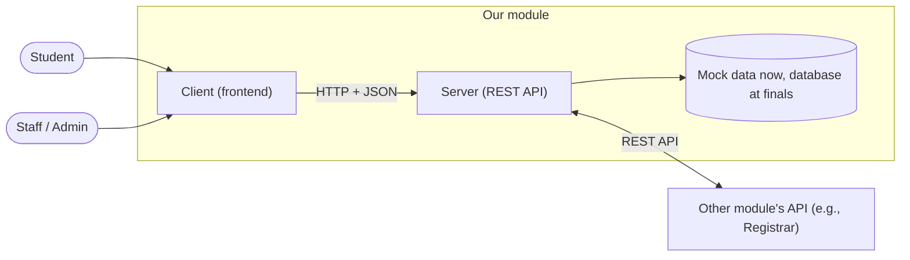
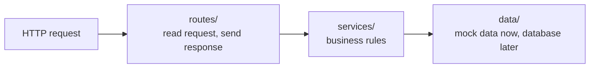
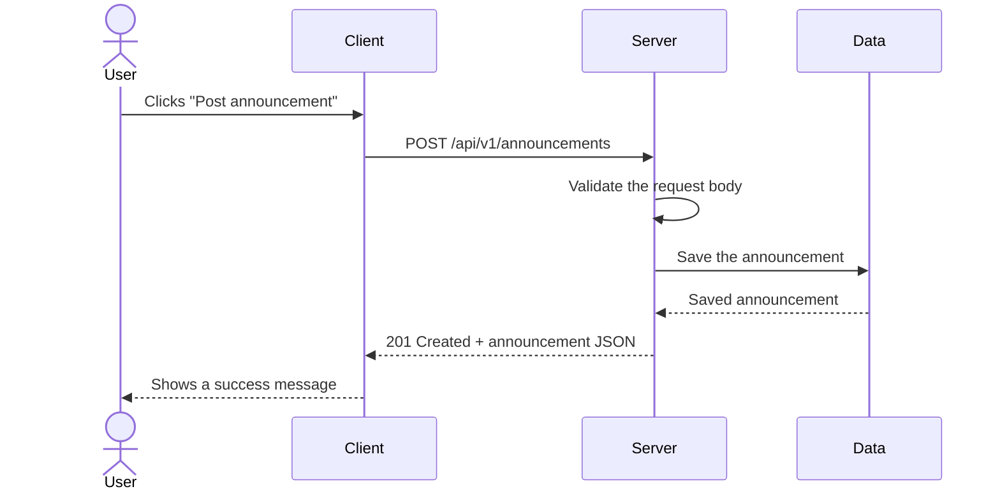

# Architecture

<!-- HINT: Owner: Documentation member. Get the details from the Backend and Frontend members.
     Goal: a new teammate reads this page and understands how everything fits together in 5 minutes.
     The diagrams below are EXAMPLES. Change them to match your module. Delete the hints when you're done. -->

## 1. Overview

<!-- HINT: 3–5 sentences. What does the module do? What are its main parts? How do they communicate? -->

[Overview of the module.]

## 2. System Context

<!-- HINT: Who and what talks to our module? Show the users, our client and server, and the other modules we connect to. -->

## 3. Building Blocks

| Part | Technology | What it does | Where it lives |
|------|------------|--------------|----------------|
| Client | [e.g., React + Vite] | The screens users see. Calls the API | `client/` |
| Server | [e.g., FastAPI] | Business rules. Provides the REST API | `server/` |
| API contract | OpenAPI 3.0 | Lists every endpoint | `server/openapi.yaml` |
| Data | Mock data (midterm), [database] (finals) | Stores [what data] | `server/src/data/` |

## 4. Backend Layers

<!-- HINT: Keep this if you follow the layers in server/README.md. If you changed them, update the diagram. -->

Every request goes through the layers in this order, and no layer is skipped. When the database is added at finals, only `data/` changes. Routes and services stay the same.

## 5. Frontend Structure

<!-- HINT: List the main screens. The "Endpoints used" column shows which parts of the API each screen depends on. -->

| Screen | URL in the app | Who can see it | Endpoints used |
|--------|----------------|----------------|----------------|
| [e.g., Announcements list] | `/announcements` | Everyone | `GET /announcements` |
| [e.g., New announcement form] | `/announcements/new` | Staff | `POST /announcements` |

## 6. Example Request Flow

<!-- HINT: Pick ONE important feature and trace it from the user's click to the data and back. -->

## 7. Cross-Cutting Concerns

<!-- HINT: "Cross-cutting" means things that apply to the WHOLE system, not one feature. -->

| Concern | How we handle it |
|---------|------------------|
| Configuration | Environment variables (`.env`). See `server/.env.example` |
| Input validation | [e.g., Pydantic models in the routes layer] |
| Error handling | Every error returns Problem Details JSON (see `server/API-CONTRACT.md`) |
| Logging | [e.g., log every request and every error to the console] |
| Authentication | [Not in midterm. Planned: ...] |
| CORS | The server allows only the URLs in `CORS_ORIGINS` |

## 8. Deployment

<!-- HINT: Not needed for midterm. Fill this in when you deploy: where it runs, how to deploy, URLs. -->

Not applicable yet.

## 9. Known Limitations and Future Work

- No database yet. Data resets every time the server restarts.
- [Add more]
