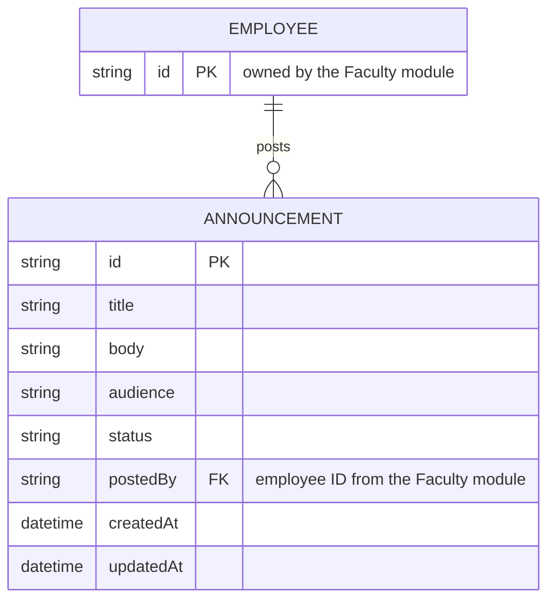

# Data Model

<!-- HINT: Owner: Documentation member. Get the details from the Backend member.
     You don't have a database yet, but design your data NOW. Your mock data and the schemas in
     server/openapi.yaml must follow this design, and at finals it becomes your database tables.
     The "Announcement" content below is an EXAMPLE. Replace it with your own entities. -->

## 1. Entities

<!-- HINT: An "entity" is a kind of thing you store (Book, Loan, Payment, Patient Visit...). -->

| Entity | What it is | Owned by |
|--------|------------|----------|
| Announcement | A message posted for students, faculty, or staff | This module |
| Employee | The person who posted it | Faculty module (we store only their ID) |

## 2. Entity Relationship Diagram

<!-- HINT: Relationship symbols: ||--o{ means "one to many", ||--|| means "one to one".
     Mermaid ER syntax: https://mermaid.js.org/syntax/entityRelationshipDiagram.html -->

## 3. Entity Details

<!-- HINT: Copy this section for each entity. Field names and types must match server/openapi.yaml exactly. -->

### Announcement

| Field | Type | Required | Description | Example |
|-------|------|:--------:|-------------|---------|
| `id` | string | ✅ | Unique ID, generated by the server | `ANN-0001` |
| `title` | string (max 150) | ✅ | Headline | `Enrollment is now open` |
| `body` | string | ✅ | Full message | `Online enrollment runs from...` |
| `audience` | enum `Audience` | ✅ | Who should see it | `students` |
| `status` | enum `AnnouncementStatus` | ✅ | Current state | `published` |
| `postedBy` | string | ✅ | Employee ID of the author (Faculty module) | `EMP-0042` |
| `createdAt` | date-time | ✅ | Set by the server when created | `2026-09-25T08:00:00Z` |
| `updatedAt` | date-time | ✅ | Set by the server on every change | `2026-09-25T08:00:00Z` |

**Business rules:**

- An archived announcement can't be edited. Trying returns `409 Conflict`.
- [Add your rules]

## 4. Enumerations (fixed lists of values)

| Enum | Allowed values | Meaning |
|------|----------------|---------|
| `Audience` | `everyone`, `students`, `faculty`, `staff` | Who the announcement is for |
| `AnnouncementStatus` | `published`, `archived` | Whether it's still shown |

## 5. References to Other Modules

<!-- HINT: Any field that stores another module's ID. The owner module is the "source of truth" for that data.
     See docs/integration.md for the ID formats the class agreed on. -->

| Our field | Points to | Owner module |
|-----------|-----------|--------------|
| `Announcement.postedBy` | Employee ID | Faculty |

## 6. Mock Data (Midterm)

- **Location:** `server/src/data/`
- **Records per entity:** [e.g., 5–10 realistic records]
- **Notes:** IDs from other modules use the formats agreed on in `integration.md`.

## 7. Planned Database (Finals)

<!-- HINT: Not needed for midterm, but think about it early. -->

- **Database:** [e.g., PostgreSQL / MySQL / SQL Server / MongoDB]
- **Naming convention:** [e.g., tables are plural snake_case (`announcements`), columns are snake_case (`created_at`), and the API converts them to camelCase]
- **Constraints and indexes to add:** [e.g., unique `id`, index on `status`]
