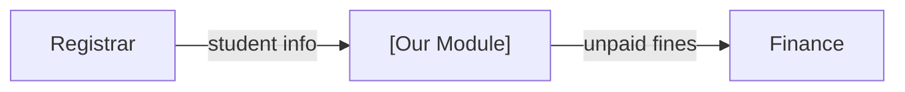

# Integration

<!-- HINT: Owner: Documentation member, working with the Backend member.
     This course is System Architecture and INTEGRATION, and this page is where integration is documented:
     how your module shares data with the other seven modules. Keep it current, because other groups will read it. -->

How **[Module Name]** connects with the other modules of the College Management System.

## 1. Module Directory

<!-- HINT: Fill in the groups you work with (ask them for their links).
     Suggested ports: give each module its own port so several modules can run on one laptop at the same time.
     Use your module's port in server/.env and in the `servers` URL in server/openapi.yaml. -->

| Module | Group | Repo link | Suggested API port | Swagger UI |
|--------|-------|-----------|:------------------:|------------|
| Landing Page | | | 8001 | `http://localhost:8001/docs` |
| Library | | | 8002 | `http://localhost:8002/docs` |
| Student Portal | | | 8003 | `http://localhost:8003/docs` |
| Finance | | | 8004 | `http://localhost:8004/docs` |
| Faculty | | | 8005 | `http://localhost:8005/docs` |
| Clinic | | | 8006 | `http://localhost:8006/docs` |
| Registrar | | | 8007 | `http://localhost:8007/docs` |
| Inventory | | | 8008 | `http://localhost:8008/docs` |

## 2. Who Owns Which Data (Source of Truth)

Each piece of shared data has **one** owner module. Other modules get it through the owner's API and don't keep their own master copy. This prevents conflicts like two modules having different names for the same student.

<!-- HINT: Agree on this AS A CLASS. The rows below are EXAMPLES to start the discussion. -->

| Data | Owner module | Shared ID field and format |
|------|--------------|----------------------------|
| Student records (name, program, year level) | Registrar | `studentId`, e.g. `2026-00123` |
| Faculty and employee records | Faculty | `employeeId`, e.g. `EMP-0042` |
| Fees, balances, payments | Finance | [...] |
| Books and loans | Library | [...] |
| Clinic visits and health clearances | Clinic | [...] |
| Supplies and equipment | Inventory | [...] |

**Sensitive data** (health records, grades, balances): share only what the other module actually needs. For example, the Clinic can answer "Is this student cleared? yes/no" without sharing the diagnosis.

## 3. What We PROVIDE to Other Modules

<!-- HINT: Endpoints in YOUR openapi.yaml that other modules call. -->

| Data or action | Our endpoint | Used by | Notes |
|----------------|--------------|---------|-------|
| [e.g., A student's unpaid library fines] | `GET /api/v1/fines?studentId={studentId}` | Finance | [...] |

## 4. What We NEED from Other Modules

<!-- HINT: Endpoints in OTHER modules' APIs that we call.
     Until their API is ready, use their openapi.yaml: either run a Prism mock server of it
     (see client/README.md) or put sample responses that match their schema in server/src/data/. -->

| What we need | From module | Their endpoint | Why we need it | If their API is down |
|--------------|-------------|----------------|----------------|----------------------|
| [e.g., Student name and program] | Registrar | `GET /api/v1/students/{studentId}` | Show who borrowed a book | Show the student ID only |

## 5. Integration Diagram

<!-- HINT: Show only the modules you connect to. Label each arrow with what data flows. -->

## 6. Shared Conventions

All modules follow the class-wide API conventions in [server/API-CONTRACT.md](../server/API-CONTRACT.md#class-wide-api-conventions): base path `/api/v1`, camelCase JSON, ISO 8601 dates, Problem Details errors, and Swagger UI at `/docs`.

## 7. Agreements Log

<!-- HINT: Every time you agree on something with another group, write it here. This prevents "we never said that!" later. -->

| Date | With group | What we agreed | Link (chat, issue, or PR) |
|------|------------|----------------|---------------------------|
| [YYYY-MM-DD] | [Registrar] | [They provide GET /students/{studentId} returning studentId, fullName, program, yearLevel] | [...] |

## 8. Open Questions and Blockers

- [e.g., Waiting for Finance to confirm the payment status values]
